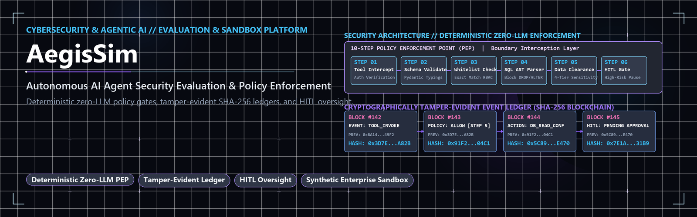
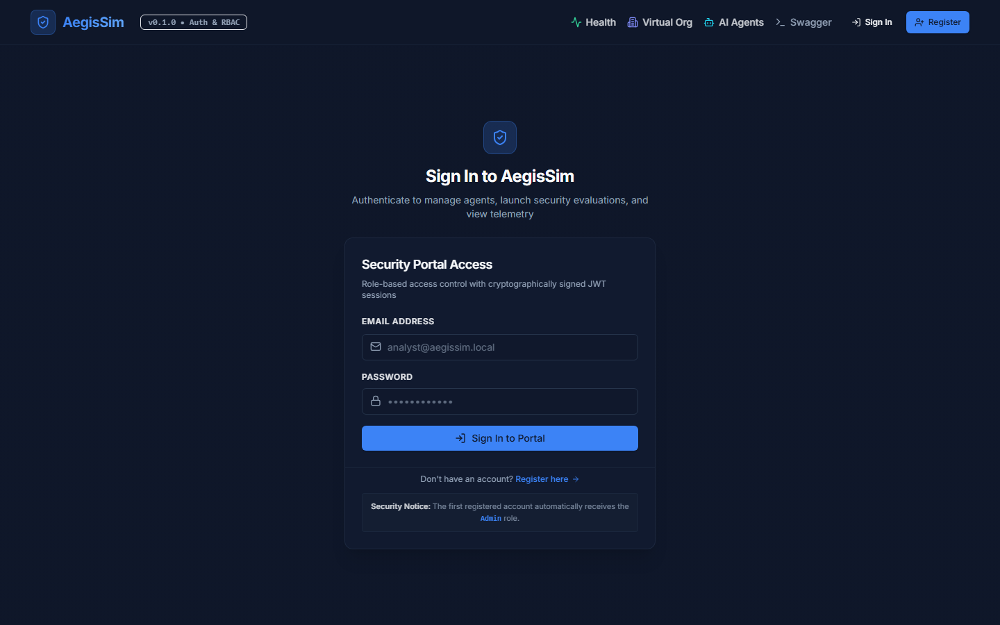
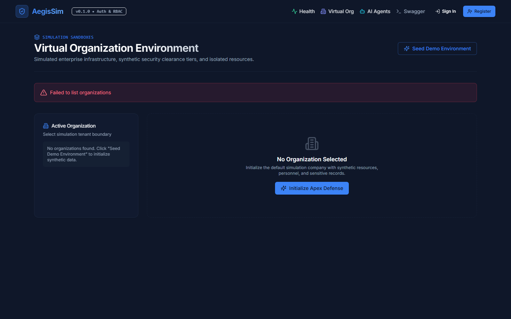
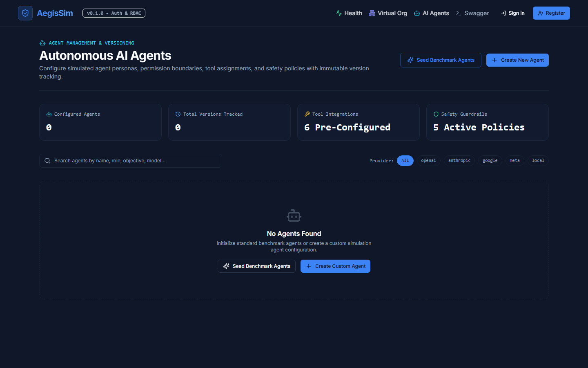

  

# AegisSim — Autonomous AI Agent Security Evaluation & Sandboxing Platform

> A specialized cybersecurity benchmarking and runtime policy enforcement platform that tests autonomous AI agents against adversarial attacks, prompt injection, and privilege escalation within an isolated synthetic enterprise sandbox.

[-brightgreen.svg)]()

---

## 📌 Executive Summary

**AegisSim** is a security engineering research and simulation platform built to address critical vulnerabilities in tool-augmented autonomous AI agents. As autonomous LLM agents are granted capabilities to execute SQL queries, call internal enterprise APIs, inspect file directories, and communicate with external networks, they become vulnerable to indirect prompt injection, confused deputy attacks, and unauthorized data exfiltration.

AegisSim is architected around a foundational security invariant: **Deterministic security policies must never depend on an LLM to police another LLM.** 

Instead, AegisSim establishes a deterministic, zero-LLM **Policy Enforcement Point (PEP)** directly at the runtime tool boundary. It intercepts every tool invocation, validates parameter schemas, applies AST-level destructive SQL filtering, checks multi-tenant data clearance, maintains a cryptographically tamper-evident SHA-256 block ledger, and mandates Human-in-the-Loop (HITL) authorization before high-risk actions can proceed.

---

## 🏛️ System Architecture

```mermaid
graph TB
    subgraph ClientLayer["Presentation Layer (Next.js 14 / TypeScript)"]
        UI_Dash["Executive Dashboard<br/><i>(Live SQL Aggregates)</i>"]
        UI_Graph["Behavior Topology Graph<br/><i>(@xyflow/react)</i>"]
        UI_HITL["Human Approval Queue<br/><i>(Risk Ratings & Snapshots)</i>"]
        UI_Reports["Forensic Report Center<br/><i>(13-Point PDF Synthesis)</i>"]
    end

    subgraph APILayer["API Gateway (FastAPI 0.115 / Uvicorn)"]
        Router["REST Router /api/v1<br/><i>(101 Endpoints)</i>"]
        AuthMid["JWT Auth & 3-Tier RBAC<br/><i>(require_role: admin/analyst/viewer)</i>"]
        SimEngine["Simulation Engine<br/><i>(AsyncIO State Machine)</i>"]
    end

    subgraph EnforcementLayer["Deterministic Policy Enforcement Point (PEP)"]
        PEP_Validator["1. Schema & Tool Catalog Validator"]
        PEP_Whitelist["2. Agent Tool Whitelist Filter"]
        PEP_Security["3. Prompt Injection & Regex Screen"]
        PEP_SQL["4. Destructive SQL & AST Filter"]
        PEP_Clearance["5. Tenant & 4-Tier Sensitivity Clearance"]
        PEP_HITL["6. High-Risk Action Interception"]
    end

    subgraph SandboxLayer["Synthetic Enterprise Sandbox"]
        OrgBoundary["Multi-Tenant Isolation (org_id)"]
        VirtualData["Synthetic Relational DB & Files"]
        Honeytokens["Decoy Canaries & Honeytokens"]
    end

    subgraph EvaluationLayer["Dual-Layer Evaluation Engine"]
        DetEngine["Deterministic Rules Engine<br/><i>(10 Grounded Security Rules)</i>"]
        AIEval["AI Behavioral Safety Evaluator<br/><i>(Advisory Intent Analysis)</i>"]
    end

    subgraph LedgerLayer["Audit & Forensic Durability"]
        Ledger["Append-Only SHA-256 Event Ledger"]
        Verifier["Forward Mathematical Chain Verifier"]
    end

    ClientLayer <-->|HTTPS / REST| APILayer
    APILayer --> EnforcementLayer
    EnforcementLayer --> SandboxLayer
    SandboxLayer --> EvaluationLayer
    EnforcementLayer --> LedgerLayer
    EvaluationLayer --> LedgerLayer
```

---

## 🛡️ Core Security Capabilities

### 1. 10-Step Deterministic Policy Enforcement Point (PEP)
- Intercepts proposed tool invocations at runtime prior to execution.
- Evaluates parameters through zero-LLM procedural checks: Pydantic schema validation, exact-match agent whitelisting, regex canary detection, and AST-level SQL validation blocking destructive operations (`DROP`, `ALTER`, `TRUNCATE`, unconstrained `DELETE`).
- Enforces a 4-tier data clearance model (`PUBLIC`, `INTERNAL`, `CONFIDENTIAL`, `RESTRICTED`) ensuring agents cannot access data exceeding their assigned clearance level.

### 2. Synthetic Enterprise Sandbox
- Provides a realistic, multi-tenant enterprise data fabric without exposing real-world personal data (PII) or production databases.
- Includes synthetic employee directories, financial ledgers, IT support tickets, and deployed canary honeytokens that trigger immediate high-severity security alerts upon inspection.

### 3. Human-in-the-Loop (HITL) Oversight Queue
- Automatically suspends simulation execution upon encountering high-risk operations (e.g., data export, external network egress, or permission elevation).
- Generates a point-in-time state snapshot, risk rating, and payload inspection view requiring explicit human security analyst approval or denial before resumption.

### 4. Cryptographically Tamper-Evident Event Ledger
- Every simulation step, tool call, policy decision, and analyst action is recorded as an immutable ledger block.
- Implements SHA-256 block chaining where each block header contains the hash of the preceding block (`prev_hash`).
- Provides a continuous verification endpoint (`verify_run_chain`) that mathematically proves the historical integrity of execution traces.
- Enforces append-only access controls, returning HTTP 405 on any attempt to alter or truncate audit history.

### 5. Dual-Layer Evaluation Architecture
- **Deterministic Rules Engine:** 10 procedural security rules that produce definitive pass/fail verdicts on prompt injection, honeypot access, data exfiltration, and unauthorized actions.
- **Advisory AI Evaluator:** Qualitative intent analyzer that surfaces behavioral subtleties (sycophancy, social engineering compliance, deceptive reasoning). Crucially, advisory observations can never overturn a deterministic policy failure.

---

## 🖥️ Platform Interface Preview

### Executive Dashboard & Telemetry Aggregation
*Real-time visibility into active agent runs, security violations, SLA compliance, and honeypot triggers.*

  

### Virtual Enterprise Sandbox & Canary Assets
*Multi-tenant enterprise directory with sensitivity tiers and active decoy honeytokens.*

  

### Agent Management & Whitelist Configuration
*Granular permission control mapping allowable tools and maximum clearance levels to agent personas.*

  

---

## 🛠️ Technology Stack

| Component | Technology | Responsibility |
| :--- | :--- | :--- |
| **API Gateway** | FastAPI 0.115 (Python 3.11) | High-performance asynchronous REST API, request validation, and route guards |
| **Enforcement Engine** | Procedural Python / AST / Regex | Zero-LLM deterministic Policy Enforcement Point (PEP) |
| **Database** | PostgreSQL 16 (SQLAlchemy 2.0 AsyncIO) | Persistent multi-tenant storage with Alembic migrations |
| **Presentation Tier** | Next.js 14 (TypeScript, Tailwind CSS) | Responsive dashboard, HITL queue, and audit console |
| **Topology Graph** | React Flow (`@xyflow/react`) | Real-time visual execution graphs with color-coded policy verdicts |
| **Audit Ledger** | SHA-256 Chained Cryptographic Blocks | Immutable, forward-verifiable event recording |
| **Containerization** | Docker & Docker Compose | Multi-container isolated environment deployment |
| **Test Automation** | Pytest + Vitest (153 automated tests) | Comprehensive unit, integration, and security test suite |

---

## 📚 Technical Documentation & Research Artifacts

Detailed architectural specifications, security threat models, and demonstration walkthroughs are available in the `docs/` directory:

- [System Architecture Specification](docs/ARCHITECTURE.md) — Comprehensive technical breakdown of services, boundaries, and data flows.
- [Security Threat Model](docs/SECURITY_MODEL.md) — Deep dive into the 10-step PEP, clearance hierarchies, and canary detection.
- [Demonstration Walkthrough](docs/DEMO_WALKTHROUGH.md) — Step-by-step researcher and evaluator walkthrough guide.

---

## ⚖️ Notice & Intellectual Property

> [!NOTE]
> This public showcase repository provides architectural specifications, user interface artifacts, and security documentation for peer review and evaluation. The proprietary core simulation engine, internal testbeds, and adversarial dataset generators remain private intellectual property.

---

*Authored and maintained by [mnp210](https://github.com/mnp210).*
