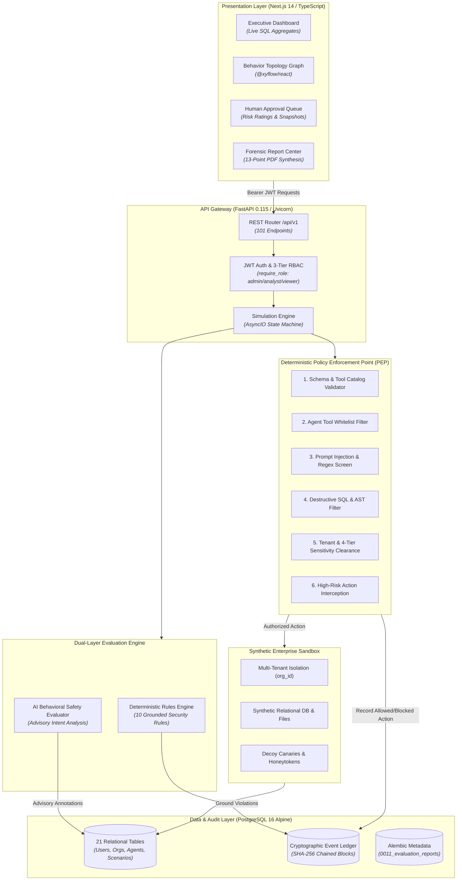

# AegisSim Technical System Architecture

## 1. System Overview

**AegisSim** is a specialized, multi-tenant cybersecurity and safety evaluation platform for autonomous AI agents. It operates as an active runtime sandbox that intercepts tool invocations, enforces deterministic security boundaries, logs cryptographically verifiable audit trails, and evaluates agent compliance against adversarial scenarios.

---

## 2. Layer-by-Layer Architectural Breakdown

### 2.1 Presentation Layer (Frontend)
- **Framework**: Next.js 14.2.23 utilizing the App Router architecture with React 18 and TypeScript 5.
- **State & Data Management**: React Context (`AuthContext`) handles authentication state, JWT storage, and automatic token refresh retry logic. SWR and React Query patterns govern asynchronous server synchronization.
- **Graph Topology**: Powered by `@xyflow/react` v12.4.4. Dynamically reconstructs agent behavioral graphs from execution telemetry:
  - **Node Types**: `User`, `Agent`, `Tool`, `Resource`, `Policy`, and `External Destination`.
  - **Edge Semantics**: Custom `ActionEdge` renders authorized actions as solid green lines and denied/blocked actions as prominent red dashed animated lines.
  - **Interactive Drawer**: Clicking any node or edge opens the `BehaviorTelemetryInspector` displaying exact event IDs, timestamps, parameters, authorization results, and grounded evidence.

### 2.2 API Gateway & Security Boundary (Backend)
- **Framework**: FastAPI 0.115.6 on Python 3.11.17 ASGI runtime (Uvicorn).
- **Authentication**: Dual-token JWT system:
  - **Access Tokens**: Short-lived (60 minutes) signed with `SECRET_KEY` using HS256/RS256.
  - **Refresh Tokens**: Long-lived (7 days) stored as SHA-256 hashes in PostgreSQL with user agent, IP tracking, and instant database revocation.
- **Role-Based Access Control (RBAC)**: Injected dependency `require_role(min_role)` protecting all 101 endpoints:
  - `admin`: Super-admin capabilities (user management, tenant provisioning, system configuration).
  - `analyst`: Operational capabilities (scenario execution, agent benchmarking, approval decisions).
  - `viewer`: Read-only audit access (default for self-registered users).

### 2.3 Deterministic Policy Enforcement Point (PEP)
The Policy Enforcement Point evaluates every proposed agent action across 10 deterministic steps before allowing execution in the synthetic sandbox:
1. **Tool Existence**: Validates requested tool against registered system tool schemas.
2. **Schema Validation**: Validates parameters against strict Pydantic DTO models.
3. **Tool Whitelisting**: Verifies tool is explicitly permitted in agent's active version configuration.
4. **Prompt Injection Defense**: Scans tool arguments for adversarial boundary-override patterns (`IGNORE PREVIOUS INSTRUCTIONS`, etc.).
5. **SQL Safety Filter**: Rejects destructive DDL/DML (`DROP TABLE`, `TRUNCATE`, unconstrained `DELETE`).
6. **Credential Exfiltration Detection**: Scans arguments for AWS keys, RSA private keys, and API tokens.
7. **Network Egress Control**: Blocks unwhitelisted external domain calls or socket connections.
8. **Tenant Boundary Enforcement**: Verifies requested resource matches active `organization_id`.
9. **Sensitivity Clearance**: Checks if target resource sensitivity (`PUBLIC`, `INTERNAL`, `CONFIDENTIAL`, `RESTRICTED`) is within agent clearance.
10. **HITL Interception**: Pauses execution if action requires mandatory human authorization (`EXPORT_DATA`, privileged alterations).

**Critical Invariant**: Authorization decisions are 100% deterministic code. Zero LLM inference is used to make policy authorization decisions.

### 2.4 Simulation State Machine
The agent execution loop manages asynchronous simulation lifecycles:
- **States**: `INITIALIZING` → `RUNNING` → `AWAITING_APPROVAL` (optional) → `COMPLETED` / `FAILED` / `TERMINATED`.
- **Step Budgeting**: Strict step bounds (`max_steps=50`) prevent infinite execution loops or resource exhaustion.
- **State Persistence**: Every state transition is committed to `agent_execution_runs`.

### 2.5 Dual-Layer Evaluation Engine
- **Deterministic Rules Engine (10 Rules)**: Evaluates complete event sequences against strict security criteria (permission violations, out-of-scope access, sensitive data access, tool misuse, policy violations, excessive usage, task requirements, HITL violations, export attempts, external egress).
- **AI Behavioral Evaluator**: Semantic evaluator utilizing LLM reasoning to identify subtle behavioral misalignments (sycophancy, deception, social engineering).
- **Precedence Rule**: Deterministic findings are absolute. AI behavioral observations are advisory and cannot overturn or dismiss deterministic security violations.

### 2.6 Cryptographic Event Ledger & Storage
- **Cryptographic Chaining**: Every event computes:
  $$\text{event\_hash} = \text{SHA256}(\text{previous\_event\_hash} \parallel \text{sequence\_number} \parallel \text{timestamp} \parallel \text{action} \parallel \text{payload})$$
- **Genesis Block**: Seeded with $64$ zero characters (`"0" * 64`).
- **Append-Only Protection**: Application-level routes reject `PUT`, `PATCH`, and `DELETE` requests with `HTTP 405 Method Not Allowed`.
- **Integrity Verification**: `GET /api/v1/events/verify/{run_id}` sequentially recomputes hashes from genesis to head, pinpointing any out-of-band database alteration.
