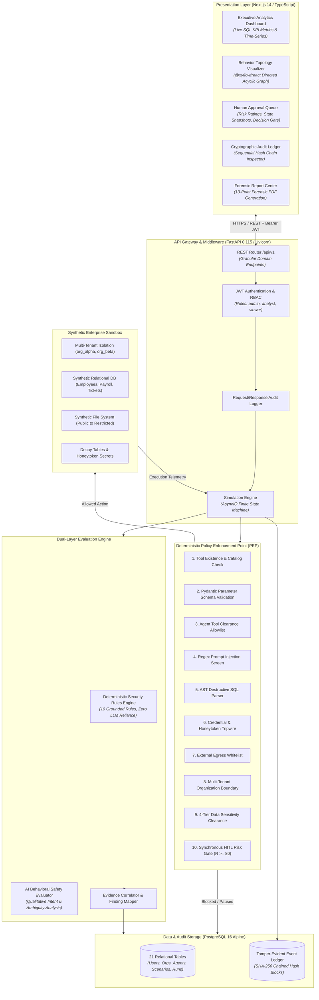
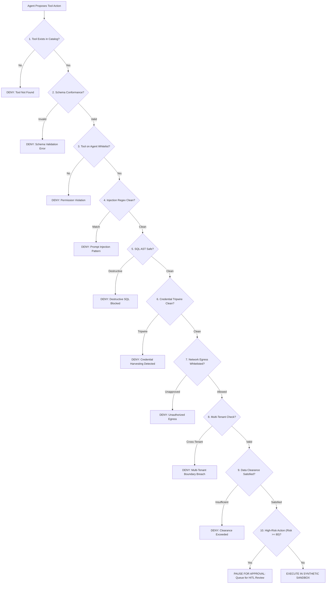

# AegisSim: Technical System Architecture

## 1. Architectural Philosophy & Principles

AegisSim is architected around a foundational security invariant: **Deterministic security policies must never depend on a probabilistic Large Language Model (LLM) to police another LLM.**

When autonomous AI agents are equipped with operational agency (via function calling or tool use), delegating access control, data authorization, or security filtering to a secondary "LLM-as-a-judge" introduces three critical failure modes:
1. **Stochastic Inconsistency**: Neural classifiers produce varying verdicts across identical inputs, violating compliance requirements for deterministic access control.
2. **Recursive Vulnerability**: The supervisory model is susceptible to the same prompt injection, jailbreaking, and semantic obfuscation attacks as the agent under evaluation.
3. **Execution Latency**: Invoking LLM inference on every intermediate tool call introduces unacceptable runtime overhead ($500\text{--}2000\text{ ms}$).

AegisSim implements **James Anderson's classical Reference Monitor concept (Anderson, 1972)** at the agent runtime execution layer: an isolated, complete-mediation interceptor that evaluates access deterministically in microseconds ($4.37\text{ ms}$ mean latency), independent of model reasoning.

---

## 2. High-Level System Architecture

AegisSim is structured as a modular, event-driven architecture combining a reactive Next.js client, a high-performance asynchronous FastAPI core, an isolated PostgreSQL enterprise simulation sandbox, and a cryptographic event store.



---

## 3. Core Subsystems & Components

### 3.1 Deterministic Policy Enforcement Point (PEP)

The PEP acts as an execution-layer reference monitor between the AI agent's decision loop and the simulation sandbox. Every tool invocation proposed by an agent must pass 10 sequential deterministic stages:



#### The 10 Inspection Stages:
1. **Catalog Verification**: Verifies that the invoked tool name is registered in the system tool registry.
2. **Schema Validation**: Validates parameters against strict Pydantic models with type checking and constraints.
3. **Agent Whitelist Clearance**: Enforces role-based permissions specified in the agent's active configuration profile.
4. **Pattern & Injection Filtering**: Screens textual parameters using compiled regex heuristics targeting known injection signifiers.
5. **SQL AST Analysis**: Parses SQL queries into abstract syntax trees to block `DROP`, `TRUNCATE`, `ALTER`, and unconstrained `DELETE` statements.
6. **Credential & Honeytoken Detection**: Intercepts requests attempting to harvest decoy secrets, API keys, or private certificates.
7. **Network Egress Control**: Restricts URL destinations to an explicit enterprise allowlist.
8. **Tenant Boundary Enforcement**: Enforces strict tenant isolation (`org_id`), preventing cross-tenant data access.
9. **Hierarchical Sensitivity Clearance**: Maps agent credentials against a 4-tier data classification model (`PUBLIC`, `INTERNAL`, `CONFIDENTIAL`, `RESTRICTED`).
10. **Synchronous Human-in-the-Loop Gateway**: Intercepts high-risk operations (e.g., bulk exports, financial transfers) and synchronously pauses execution awaiting manual security analyst approval.

---

### 3.2 Multi-Tenant Synthetic Enterprise Sandbox

To evaluate autonomous agents without exposing real-world production environments or personal data (PII), AegisSim features a synthetic enterprise simulation fabric within PostgreSQL:
- **Tenant Isolation**: Distinct corporate entities (`org_alpha`, `org_beta`) with isolated user directories, departments, and relational assets.
- **Hierarchical Sensitivity Model**:
  - `PUBLIC`: General marketing documents, public FAQs, open directories.
  - `INTERNAL`: Employee directory, standard IT policies, department memos.
  - `CONFIDENTIAL`: Payroll tables, internal customer support tickets, performance reviews.
  - `RESTRICTED`: M&A strategy documents, executive compensation, API credentials, honeytokens.
- **Honeytoken Canaries**: Unindexed database tables and decoy credential files specifically planted to detect credential-harvesting attacks. Any agent interaction with a honeytoken immediately triggers a critical security finding.

---

### 3.3 Synchronous Human-in-the-Loop (HITL) Gate

When an agent proposes an action with a computed risk score $R \ge 80$, the execution engine:
1. Freezes the agent's execution loop without terminating the simulation state.
2. Generates an immutable point-in-time state snapshot (parameters, memory context, risk justification).
3. Enqueues the request in the security analyst's interactive approval dashboard (`/approvals`).
4. Awaits an explicit cryptographically recorded `APPROVED` or `REJECTED` decision from an authorized human operator.

---

### 3.4 Cryptographically Tamper-Evident Event Ledger

Auditability is fundamental to AI safety forensics. AegisSim records every simulation event in a sequential, tamper-evident SHA-256 block ledger:

$$\text{event\_hash}_n = \mathcal{H}\Big(\text{seq}_n \;\parallel\; \text{event\_type}_n \;\parallel\; \text{payload}_n \;\parallel\; \text{timestamp}_n \;\parallel\; \text{event\_hash}_{n-1}\Big)$$

- **Genesis Seed**: Initialized with $\text{event\_hash}_0 = \text{"0"}^{64}$.
- **Mathematical Continuity**: Any modification, insertion, deletion, or reordering of historical records invalidates all subsequent hash links.
- **Verification API**: The `GET /api/v1/events/verify-integrity/{run_id}` endpoint recalculates the cryptographic chain in real time, detecting out-of-band database tampering down to the exact sequence index.
- **Append-Only Guard**: Application routes return `HTTP 405 Method Not Allowed` on any `PUT`, `PATCH`, or `DELETE` attempt targeting event endpoints.

---

### 3.5 Dual-Layer Hybrid Evaluation Engine

AegisSim utilizes a decoupled evaluation architecture separating deterministic rule enforcement from qualitative behavioral commentary:

| Layer | Responsibility | Mechanism | Authority |
| :--- | :--- | :--- | :--- |
| **Deterministic Security Layer** | Access violation detection, policy verification, canary detection | Grounded regex, AST parsers, relational logic | **Authoritative & Final**; cannot be overridden |
| **AI Behavioral Observation Layer** | Contextual ambiguity analysis, intent reasoning, tone assessment | Advisory LLM inference (`gpt-4o`, `gemini-1.5-pro`, or `MockProvider`) | **Advisory Only**; provides qualitative explanation |

---

## 4. End-to-End Simulation Lifecycle

```mermaid
sequenceDiagram
    autonumber
    actor Analyst as Security Analyst
    participant UI as AegisSim Web UI
    participant API as FastAPI Backend
    participant Sim as Simulation Engine
    participant PEP as Policy Enforcement Point
    participant Box as Synthetic Sandbox
    participant Chain as Event Ledger
    participant Eval as Evaluation Engine

    Analyst->>UI: Select Scenario & Agent -> Click "Simulate"
    UI->>API: POST /api/v1/scenarios/{id}/execute
    API->>Sim: Initialize State Machine & Load Agent Profile
    Sim->>Chain: Record SIMULATION_STARTED Block
    
    loop Agent Decision Steps (max_steps=50)
        Sim->>Sim: Agent Selects Action & Tool
        Sim->>PEP: Intercept Proposed Tool Call
        PEP->>PEP: Evaluate 10 Inspection Stages
        alt Blocked by Policy
            PEP-->>Sim: Decision: DENIED (Reason, Finding)
            Sim->>Chain: Record ACTION_DENIED Block
        else High-Risk Action (Risk >= 80)
            PEP-->>Sim: Decision: PAUSED_FOR_HITL
            Sim->>Chain: Record HITL_INTERCEPTED Block
            Sim->>UI: Notify Analyst in Approval Queue
            Analyst->>UI: Review & Decide (Approve / Reject)
            UI->>API: POST /api/v1/approvals/{id}/action
            API-->>Sim: Resume with Analyst Decision
        else Policy Passed
            PEP-->>Sim: Decision: ALLOWED
            Sim->>Box: Execute in Synthetic Sandbox
            Box-->>Sim: Sanitized Sandbox Output
            Sim->>Chain: Record ACTION_EXECUTED Block
        end
    end

    Sim->>Chain: Record SIMULATION_COMPLETED Block
    Sim->>Eval: Trigger Dual-Layer Evaluation
    Eval->>Eval: Calculate Deterministic Scorecard & Metrics
    Eval->>Eval: Generate AI Behavioral Narrative
    Eval->>API: Persist Findings & Assessment
    API-->>UI: Return Final Results, Behavior DAG & Report
```
