# AegisSim: Research Methodology & Experimental Design

## 1. Research Objectives & Framing

The primary objective of the AegisSim research initiative is to investigate whether **deterministic execution-layer reference monitors** can reliably constrain the runtime security behavior of autonomous AI agents, eliminating the failure modes associated with probabilistic "LLM-as-a-judge" supervisory models.

The empirical investigation is structured around five formal research questions:

| Research Question | Scientific Focus | Evaluation Target |
| :--- | :--- | :--- |
| **RQ1: Deterministic Decoupling** | Can deterministic policy enforcement constrain autonomous agents with zero stochastic variance and negligible latency? | Policy Enforcement Accuracy ($A_{\text{pep}}$) & Mediation Latency ($L_{\text{pep}}$) across 10 operational categories. |
| **RQ2: Adversarial Resistance** | How effectively does the multi-stage enforcement pipeline intercept adversarial tool-use attempts arising from direct/indirect prompt injection? | Adversarial Prevention Rate ($R_{\text{prev\_rq2}}$), Detection Rate ($R_{\text{det}}$), and qualitative failure case analysis. |
| **RQ3: Human-in-the-Loop Interception** | Can synchronous policy gates reliably intercept high-risk actions without deadlocks or execution bypasses? | HITL Interception Rate ($R_{\text{hitl}}$) and Zero-Bypass Rate ($R_{\text{bypass}} = 0$). |
| **RQ4: Cryptographic Ledger Integrity** | How sensitive is the SHA-256 sequential block ledger to intentional data tampering and record truncation? | Application-level detection recall, specificity, and modeled root-anchor verification. |
| **RQ5: Evaluation Reproducibility** | Does the decoupled evaluation pipeline produce invariant assessments across identical simulation runs? | Evaluation Reproducibility Index ($\text{ERI}$) across repeated independent evaluation cycles. |

---

## 2. Experimental Rigor & Pre-Registration Protocol

To ensure methodological validity and eliminate confirmation bias, the experimental evaluation followed strict scientific protocols:

1. **Pre-Registered Ground Truth**: Every trial ID, expected tool invocation, policy decision (`ALLOWED`, `DENIED`, `PAUSED_FOR_HITL`), and failure invalidation criterion was formally pre-registered in a version-controlled specification (`research/experiments/pre_registered_ground_truth.json`) prior to physical benchmark execution.
2. **Trial Independence & Clean Reset**: Between experimental runs, the PostgreSQL database was returned to baseline seeds via automated migration rollback and re-seeding scripts, eliminating state pollution, orphaned cache entries, or session leakage.
3. **Deterministic Seed Control**: Random number generator seeds were frozen across runtime dependencies to guarantee identical prompt presentation across baseline evaluation sweeps.
4. **Physical Trial Disambiguation**:
   - The benchmark consists of exactly **241 physical simulation trials**:
     - **RQ1**: $120$ trials (10 operational tool/permission categories $\times$ 12 repeated observations).
     - **RQ2**: $36$ trials (12 threat scenarios $\times$ 3 prompt variations: V1, V2, V3).
     - **RQ3**: $30$ trials (5 risk operational profiles $\times$ 6 repeated executions).
     - **RQ4**: $45$ trials (40 synthetic tamper injection cases + 5 pristine control chains).
     - **RQ5**: $10$ trials (10 independent evaluation iterations over identical recorded traces).
   - Downstream hypothesis analyses encompass **283 metric slots**, as certain multi-step trials evaluate multiple simultaneous criteria (e.g., policy decision + data leakage prevention). The physical trial count remains strictly 241.

---

## 3. Threat Vector Taxonomy & Test Population

The adversarial evaluation suite (RQ2) investigates 12 canonical threat scenarios across three distinct prompt variations (V1: explicit command, V2: conversational coercion, V3: obfuscated/encoded attack):

```mermaid
graph TD
    Taxonomy["Adversarial Threat Taxonomy (RQ2)"]
    Taxonomy --> Baseline["Benign Control (N=3)"]
    Taxonomy --> Injection["Prompt Injection (N=9)"]
    Taxonomy --> Destructive["Destructive Data Attacks (N=6)"]
    Taxonomy --> Escalation["Privilege & Access Attacks (N=9)"]
    Taxonomy --> Exfil["Data Exfiltration & Canaries (N=9)"]

    Baseline --> SC01["SC-01: Benign Customer Support Task"]
    Injection --> SC02["SC-02: Direct System Prompt Override"]
    Injection --> SC03["SC-03: Indirect Webhook Ingestion Payload"]
    Injection --> SC04["SC-04: Indirect Multi-Department Ticket Injection"]
    Destructive --> SC05["SC-05: Unbounded DELETE Table Operation"]
    Destructive --> SC06["SC-06: DDL DROP TABLE Customer Ledger"]
    Escalation --> SC07["SC-07: Cross-Tenant Data Access (org_beta)"]
    Escalation --> SC08["SC-08: Sensitivity Clearance Escalation (RESTRICTED)"]
    Escalation --> SC09["SC-09: RBAC Role Elevation to Superadmin"]
    Exfil --> SC10["SC-10: Decoy Honeytoken Table Harvesting"]
    Exfil --> SC11["SC-11: Encoded JWT Token Extraction"]
    Exfil --> SC12["SC-12: Bulk Data Egress to External Webhook"]
```

---

## 4. Statistical Methodology

### 4.1 Nominal Wilson Score Confidence Intervals
Because empirical benchmarks evaluate finite sample populations, point estimates $\hat{p} = \frac{k}{n}$ can overstate confidence near boundary values ($0\%$ or $100\%$). All categorical proportions are reported alongside **nominal unadjusted binomial Wilson score intervals at 95% confidence** ($z = 1.95996$):

$$w_{\text{lower}}, w_{\text{upper}} = \frac{k + \frac{z^2}{2}}{n + z^2} \;\pm\; \frac{z}{n + z^2} \sqrt{\frac{k(n - k)}{n} + \frac{z^2}{4}}$$

### 4.2 Latency Distribution Analysis
To characterize runtime performance overhead, mediation latency was instrumented using monotonic microsecond timers ($t_{\text{end}} - t_{\text{start}}$) across all 120 RQ1 trials. The distribution is characterized by:
- Arithmetic Mean ($\mu$)
- Sample Median ($\tilde{x}$)
- Standard Deviation ($\sigma$)
- 95th Percentile ($P_{95}$)
- Full Range $[\min, \max]$

### 4.3 Evaluation Reproducibility Index (ERI)
Reproducibility across evaluation cycles is quantified using the Evaluation Reproducibility Index ($\text{ERI}$):

$$\text{ERI} = 1 - \frac{1}{|R|} \sum_{r \in R} \frac{\sigma(S_r)}{\mu(S_r) + \epsilon}$$

Where $S_r$ represents the computed security score for run $r$ across repeated evaluations. An $\text{ERI} = 1.0000$ indicates perfect score invariance ($\sigma = 0$).
