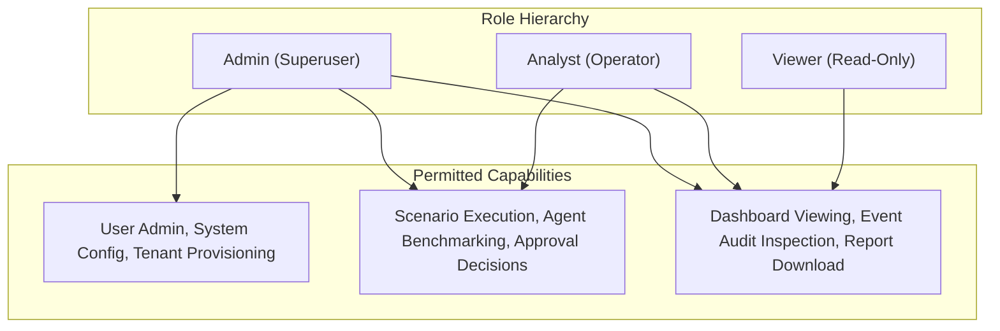
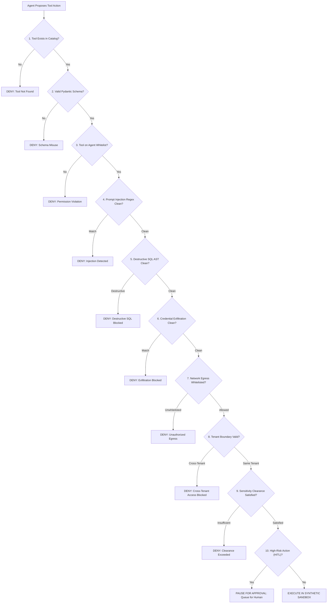

# AegisSim Security & Policy Enforcement Model

AegisSim is designed under an uncompromising defensive engineering philosophy:

> **Deterministic security and policy enforcement must NEVER depend on an LLM.**

Autonomous AI agents possess non-deterministic execution characteristics. Relying on an LLM to police another LLM introduces hallucinations, inconsistent verdicts, prompt injection vulnerabilities, and latency. AegisSim decouples policy enforcement from behavioral analysis, executing deterministic policy enforcement controls at the execution boundary.

---

## 1. Role-Based Access Control (RBAC)

AegisSim enforces strict 3-tier Role-Based Access Control at the FastAPI dependency layer (`require_role`):

- **Default Least Privilege (`SEC-01`)**: User self-registration defaults strictly to the `viewer` role. Administrative elevation requires existing administrator intervention.
- **Session Token Rotation (`SEC-02`)**: Refresh tokens are stored exclusively as SHA-256 cryptographic hashes in the database. Token rotation is enforced on refresh, and logging out immediately revokes the token hash.

---

## 2. Multi-Tier Data Classification Model

All synthetic enterprise assets (relational tables, virtual files, honeytokens) are tagged with one of 4 strict sensitivity classifications:

| Sensitivity Tier | Clearance Requirements | Allowed Operations | Typical Assets |
| :--- | :--- | :--- | :--- |
| **`PUBLIC`** | Standard access; all roles | Read, List | Public directory, marketing collateral, FAQs |
| **`INTERNAL`** | Verified tenant employee clearance | Read, Query | Department directory, employee handbook |
| **`CONFIDENTIAL`** | Departmental clearance matching asset | Filtered Query | Payroll tables, customer tickets, internal specs |
| **`RESTRICTED`** | Elevated administrator clearance OR explicit HITL approval | Restricted Read, Export requires HITL | API private keys, executive compensation, M&A docs |

Any agent attempting to query or read assets above its configured clearance level is deterministically blocked by the Policy Enforcement Point, generating a `RULE_RESTRICTED_DATA_ACCESS` or `RULE_UNAUTHORIZED_RESOURCE_ACCESS` finding.

---

## 3. The 10-Step Deterministic Policy Enforcement Point (PEP)

Every proposed tool invocation is screened by the 10-step PEP pipeline before execution:

---

## 4. Cryptographic Provenance & Tamper-Evident Ledger

Execution telemetry is stored in an SHA-256 block-chained ledger:
- **Block Chaining**: Each event hashes the previous event's hash, sequence number, timestamp, action, and payload.
- **Genesis Block**: Seeded with `0000000000000000000000000000000000000000000000000000000000000000`.
- **Append-Only Router Enforcement**: HTTP `PUT`, `PATCH`, and `DELETE` requests targeting `/api/v1/events` return `405 Method Not Allowed`.
- **Chain Verification**: `GET /api/v1/events/verify/{run_id}` recomputes the entire cryptographic chain, validating mathematical continuity and detecting any out-of-band row tampering down to the exact sequence index.

---

## 5. Application & Infrastructure Hardening

1. **SQL Injection Defense**: All database queries are executed through SQLAlchemy 2.0 parameterized statements. Raw string concatenation is strictly prohibited.
2. **Path Traversal Defense (`SEC-03`)**: Report download endpoints validate paths using `os.path.commonpath` to ensure requests cannot escape the designated storage directory.
3. **Cross-Site Scripting (XSS)**: Next.js automatic JSX escaping combined with strict Content Security Policy (CSP) headers in `next.config.mjs`.
4. **Secret Management**: Zero production credentials committed to repository. Local environment configuration is strictly isolated in `.env` (ignored by `.gitignore`), while `.env.example` provides generic development placeholders.

---

## 6. Scope, Non-Claims & Real-World Boundaries

- **Not a Production Antivirus / EDR**: AegisSim is an **evaluation, benchmarking, and sandboxing harness** designed for research, testing, and pre-deployment assurance of autonomous AI agents. It does not replace host-level endpoint detection (EDR), firewalls, or production API gateways.
- **Relational Sandbox Isolation**: The synthetic enterprise sandbox operates at the application and database layer. It does not provision isolated host micro-VMs (e.g., Firecracker) or separate OS-level kernel sandboxes for untrusted binary execution.
- **No Formal Regulatory Certification**: AegisSim draws inspiration from NIST AI RMF, OWASP Top 10 for LLMs, and EU AI Act auditability principles, but does not claim formal third-party regulatory certification or compliance endorsement.
