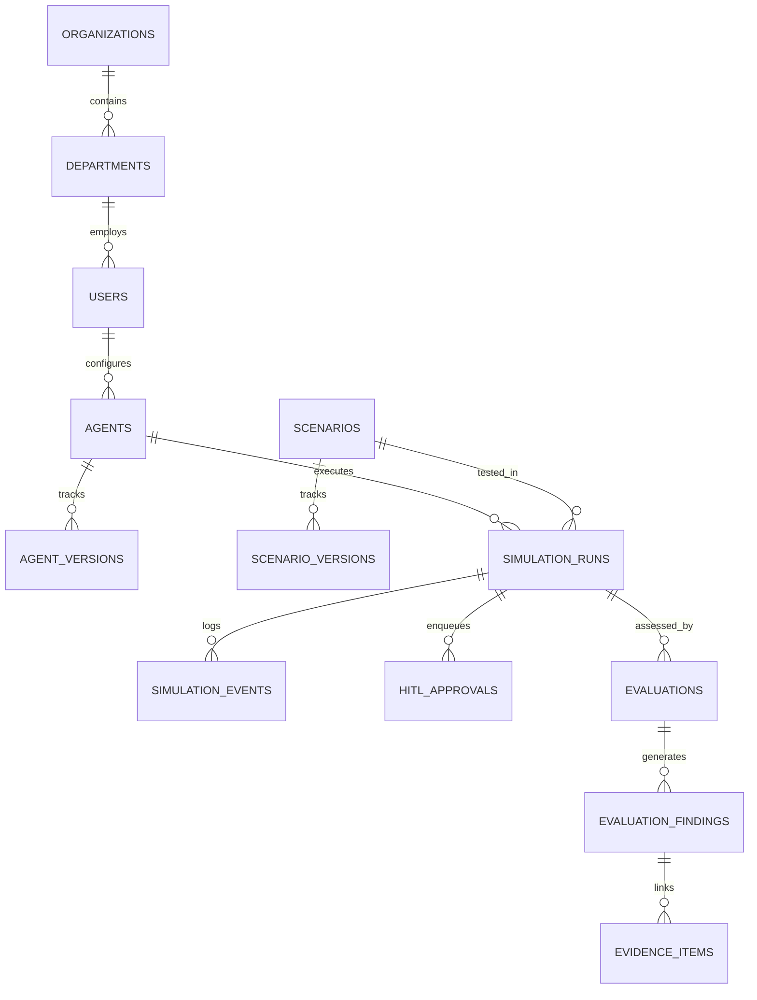

# AegisSim: Technology Stack & Engineering Specifications

## 1. Technology Matrix Overview

| Subsystem | Technology | Version | Engineering Role |
| :--- | :--- | :--- | :--- |
| **Frontend Framework** | Next.js (App Router) | 14.2+ | Server-side rendering, client hydration, dynamic routing |
| **Language (UI)** | TypeScript | 5.4+ | End-to-end static typing, interface contracts |
| **Styling & Components**| Tailwind CSS + shadcn/ui | 3.4+ / Radix UI | Accessible dark technical design system, responsive UI |
| **Graph Visualization** | @xyflow/react (React Flow)| 12.0+ | Real-time agent decision DAG & behavioral topology |
| **Backend Framework** | FastAPI | 0.115+ | High-performance asynchronous ASGI REST API gateway |
| **Language (Server)** | Python | 3.11+ | Type-annotated async core runtime |
| **Database ORM** | SQLAlchemy (AsyncIO) | 2.0+ | Fully async relational queries, parameterized statements |
| **Database Migrations**| Alembic | 1.13+ | Schema revision tracking (11 sequential migrations) |
| **Data Validation** | Pydantic | v2.8+ | Strict parameter serialization, schema conformance |
| **Relational Database**| PostgreSQL | 16-Alpine | ACID-compliant enterprise storage, multi-tenant schemas |
| **Report Generation** | ReportLab | 4.2+ | Forensic 13-point PDF assessment document synthesis |
| **Containerization** | Docker & Docker Compose | 24+ / v2 | Three-service container orchestration (Postgres, API, UI) |
| **Testing (Backend)** | Pytest + pytest-asyncio | 8.3+ | Unit, integration, security, and benchmark test suites |
| **Testing (Frontend)** | Vitest + Testing Library| 2.0+ | React component testing, hooks validation |

---

## 2. Presentation Layer Architecture (Next.js 14)

The presentation layer is built on Next.js 14 using the App Router architecture, delivering a high-assurance, responsive security operations dashboard:
- **Design System**: Customized dark technical aesthetic utilizing deep slate foundations (`#090d16`), zinc borders, and purple accent highlights (`#8b5cf6`, `#7c3aed`) reflecting the AegisSim visual identity.
- **State Management**: Reactive React 18 hooks coupled with standard fetch abstraction, avoiding bloated global state stores for localized operational views.
- **Behavioral DAG Visualization**: Implemented via `@xyflow/react`, rendering agent decision steps, tool invocations, and policy verdicts as an interactive directed acyclic graph with pan, zoom, and node inspection.
- **Defensive Rendering**: Dynamic route segments use isomorphic parameter resolution and defensive state guards to prevent unhandled hydration exceptions.

---

## 3. Backend & Core Engine Architecture (FastAPI & Python 3.11+)

The backend provides a high-throughput, low-latency API gateway and execution engine:
- **Asynchronous Concurrency**: Built on `asyncio` and `uvicorn`, enabling concurrent agent simulations without blocking main application event loops.
- **Three-Tier Role-Based Access Control (RBAC)**: Enforced via FastAPI dependency injection:
  - `admin`: Full configuration authority, scenario authoring, policy overrides, user management.
  - `analyst`: Execution initiation, approval decisioning, evaluation inspection, report generation.
  - `viewer`: Read-only access to dashboard metrics, event ledgers, and forensic archives.
- **Deterministic Policy Enforcement Point (PEP)**: Implemented as pure Python procedural code with zero asynchronous IO delays during filtering, executing in an average of $4.37\text{ ms}$.
- **Database Layer**: SQLAlchemy 2.0 async engine backed by `asyncpg`, utilizing strict parameterized queries to prevent SQL injection vulnerabilities.

---

## 4. Multi-Tenant Relational Schema (PostgreSQL 16)

The persistence tier encompasses **21 relational tables** categorized into four distinct functional domains:

1. **Identity & Governance**: `organizations`, `departments`, `users`, `roles`, `permissions`, `audit_logs`.
2. **Simulation Entities**: `agents`, `agent_versions`, `scenarios`, `scenario_versions`, `simulation_runs`.
3. **Execution Telemetry & Forensics**: `simulation_events` (tamper-evident SHA-256 chained ledger), `hitl_approvals`.
4. **Evaluation & Findings**: `evaluations`, `evaluation_findings`, `evidence_items`, `evaluation_reports`.
5. **Synthetic Enterprise Sandbox**: `sandbox_resources`, `sandbox_records`, `canary_tables`.

---

## 5. Automated Verification & Quality Assurance Suite

AegisSim maintains a strict 100% automated test pass requirement:
- **Backend Test Suite (Pytest)**: **112 passing tests** spanning unit logic, policy enforcement, database models, HITL state transitions, and cryptographic ledger verification.
- **Frontend Test Suite (Vitest)**: **41 passing tests** across 12 test suites verifying component rendering, security badges, approval interactions, and hook error boundaries.
- **Total Test Baseline**: **153 automated tests** ensuring regression-free operational reliability.
